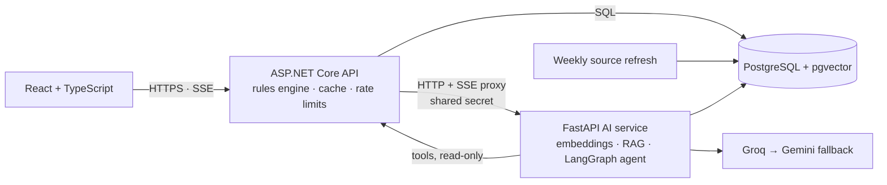

# Compass

**An independent study-abroad counsellor for Indian students choosing a master's in Ireland.**
Compass ranks courses by eligibility, real total cost and fit, explains every result,
and links every fact to the official page it came from. No commissions, no hidden partner rankings.

**Scope (MVP):** India → Ireland · taught master's · Computer Science, Data Science, AI, Software Engineering ·
24 courses across 8 universities.

> **Live demo:** https://compass-tau-three.vercel.app  (free hosting: the first request after a quiet period can take ~30 s while the backend wakes up)

## Why

Students often pay consultancies for advice that may favour partner universities, while the real
information (fees, entry requirements, living costs) is scattered across dozens of official pages.
Compass puts it in one place, computes the real cost, and shows its reasoning.

## Features

- **Eligibility check** per course: grade (with official India conversion tables), degree background,
  English test (IELTS / PTE / TOEFL, old and new TOEFL scales) and work experience, tagged
  *Eligible*, *Reach* or *Not eligible*, with a reason for each check
- **Real total cost**: tuition (with its academic year) + living costs for the course duration + one-off costs, in € and ₹
- **What-if simulator**: drag the budget and the shortlist re-ranks instantly
- **Compare** up to three courses side by side
- **Ask Compass**: a chat agent that answers from the student's shortlist and from official pages, with links
- **Freshness**: every fact has a source URL and verification date; stale data is flagged

## Architecture



**Core rule:** deterministic code decides facts; AI interprets, ranks by fit and explains.

| Decided by code (.NET, unit-tested) | Done by AI (Python) |
|---|---|
| Eligibility | Understanding interests and goals |
| Total cost and budget fit | Course-fit scoring (embeddings + pgvector) |
| Data freshness flags | Grounded answers with citations (RAG) |
| Ranking formula | Counsellor agent with read-only tools |

The AI can reorder courses through the fit score. It can never change whether a student is eligible or what a course costs.

## Engineering highlights

- **Never falsely green.** A course is *Eligible* only when every requirement is published and met; anything
  unpublished shows *Check requirements*, borderline cases show *Reach*. Each requirement links to the official page it came from.
- **Explainable ranking.** Explicit weights the student can change (balanced, best fit, lowest cost), with the score
  breakdown shown for every course. Deterministic tie-breaks.
- **Uncertainty is labelled.** Fees from earlier academic years, derived values and stale data are tagged; rupee budgets
  convert at the European Central Bank's dated reference rate.
- **Grounded chat.** Every link in an answer is checked against the sources the agent actually retrieved, and the student sees the result.
- **Correction loop.** "Report an error" on every course feeds a review queue; a weekly job re-fetches official pages and lists changes.

- **LLM kept off the hot path.** Shortlist and what-if never call an LLM: the catalog is cached in memory,
  fit scores are cached per interest set, and the rules engine evaluates every course in memory.
- **Graceful degradation.** If the AI service or every LLM provider is down, the shortlist, costs and
  simulator still work; the response says fit scoring is unavailable.
- **Resilience.** Timeouts, retries and a circuit breaker between services; Groq → Gemini fallback for chat;
  a rolling-window budget keeps embedding calls inside the free-tier quota.
- **Abuse protection.** Per-IP rate limits (API 60/min, chat 10/min) and a shared secret so only the API
  can reach the AI service.
- **Agent safety.** Step-limited LangGraph loop (max 4 tool calls), read-only tools, retrieved pages treated as data.
- **Data quality.** Curated from official pages only; estimates and fee years are labelled; a weekly job
  re-fetches sources and lists changed pages for re-verification.
- **Observability.** OpenTelemetry tracing across services, health and readiness probes.

Details: [docs/decision-engine.md](docs/decision-engine.md) · [docs/system-design.md](docs/system-design.md) · [docs/deployment.md](docs/deployment.md) · [data/README.md](data/README.md)

### Operating it in production
- **Anonymous usage analytics**: searches, chats, reports and "was this helpful?" votes go into a bounded in-memory queue and are batch-written by a background service, so analytics can never slow or break a request. No names, emails, IPs or profile values are stored. See [docs/operations.md](docs/operations.md).
- **Uptime and keep-warm**: a scheduled workflow checks `/health/ready` during active hours; a failure emails the owner.
- **Nightly decision checks**: golden student profiles run against the live API every night and fail on any broken invariant.
- **Feedback loop**: every "Report an error" becomes a GitHub issue automatically, verified against the official page before data changes.

## Tech stack

| Layer | Technology |
|---|---|
| Web | React 19, TypeScript, Vite |
| API | ASP.NET Core (.NET 10) minimal APIs, Dapper, Npgsql, Polly resilience, OpenTelemetry |
| AI | Python, FastAPI, LangGraph, LangChain, Gemini embeddings, Groq / Gemini chat |
| Data | PostgreSQL + pgvector (HNSW) |
| Ops | Docker Compose, GitHub Actions, Render, Vercel, Neon |

## Testing and evaluation

- **Unit tests:** rules engine (xUnit), AI service including an end-to-end agent run with a scripted model (pytest),
  SSE parsing (Vitest). All run in CI on every push.
- **Retrieval evaluation:** `python -m evals.rag_eval` over 12 real student questions: **hit@6 = 1.00, MRR = 0.84**
  (the correct official page is in the top 6 results for every question, and usually ranked first).
- **Golden profiles:** `python -m evals.golden_profiles` checks shortlist invariants against a running API
  (ineligible never above eligible, costs add up, every result sourced and explained, more budget never means fewer options).

## Run locally

```bash
cp .env.example .env
docker compose up -d db                          # PostgreSQL + pgvector on :5433

cd ai && python3 -m venv .venv && source .venv/bin/activate
pip install -r requirements-dev.txt && pytest
cp .env.example .env                             # add free GEMINI_API_KEY and GROQ_API_KEY
python -m scripts.load_courses ../data/courses.csv
python -m scripts.load_costs
python -m scripts.ingest ../data/sources.txt
uvicorn app.main:app --port 8000

cd ../api && dotnet test && dotnet run --project src/Compass.Api   # http://localhost:5080
cd ../web && npm install && npm run dev                            # http://localhost:5173
```

Or everything in Docker: `docker compose --profile app up -d --build` → http://localhost:3000

## Project structure

    api/   ASP.NET Core API, domain rules engine, xUnit tests
    ai/    FastAPI service: embeddings, retrieval, agent, ingestion scripts, evals
    web/   React + TypeScript frontend
    db/    PostgreSQL + pgvector migrations
    data/  Curated course and cost data (official sources only)
    docs/  System design and deployment

## Roadmap

- [x] Rules engine, API hardening, AI service, web app, CI
- [x] 24 sourced courses: fees, English requirements, India grade minimums, accepted backgrounds, living costs
- [x] Evaluation suite
- [x] Free-tier deployment (Vercel, Render, Neon) and live demo
- [ ] Alternative entry routes (work experience, RPL) and per-band English minimums
- [ ] More countries

*Not legal or immigration advice. Always confirm on the official university and government sites.*
